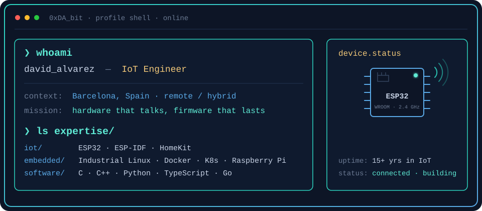

  

 

**David Álvarez (aka 0xDA_bit)** is an **IoT Engineer** based in **Barcelona, Spain** · Remote / Hybrid

**15+ years** building connected devices and **25+ years** working with hardware, from the board up to the deployment.

- **IoT firmware** — ESP32 / ESP-IDF, Apple HomeKit integrations
- **Industrial embedded Linux** — image-based systems and containerized services with Docker and Kubernetes
- **Embedded hardware & software** — Raspberry Pi, smart home and AI
- **Languages** — C, C++, Python, Bash, Go, Java, TypeScript, React · learning Rust

B.Eng. in Industrial Electronics Engineering

---

## `$ whoami`

  

---

## `$ cat tech-stack.yaml`

<table>
  <tr>
    <td width="50%" valign="top"><code>├─ iot_&amp;_embedded_linux:</code>  
      
      
      
      
       ESP32 · ESP-IDF · HomeKit · Raspberry Pi · Embedded Linux
    </td>
    <td width="50%" valign="top"><code>├─ languages:</code>  
      
      
      
      
      
      
       C · C++ · Python · Bash · Go · Java
    </td>
  </tr>
  <tr>
    <td valign="top"><code>├─ web_&amp;_apps:</code>  
      
      
      
       TypeScript · React · Astro
    </td>
    <td valign="top"><code>├─ tools:</code>  
      
      
      
      
      
      
       Git · GitHub · VS Code · Docker · Kubernetes · MySQL
    </td>
  </tr>
  <tr>
    <td colspan="2" valign="top"><code>╰─ learning:</code>  
      
       Rust
    </td>
  </tr>
</table>

---

[LinkedIn](https://www.linkedin.com/in/0xdabit) · [YouTube](https://www.youtube.com/@0xDAbitLabs) · [oxdabit.com](https://oxdabit.com) · [hello@oxdabit.com](mailto:hello@oxdabit.com)

David Álvarez · 0xDA_bit · IoT Engineer · Barcelona, Spain

